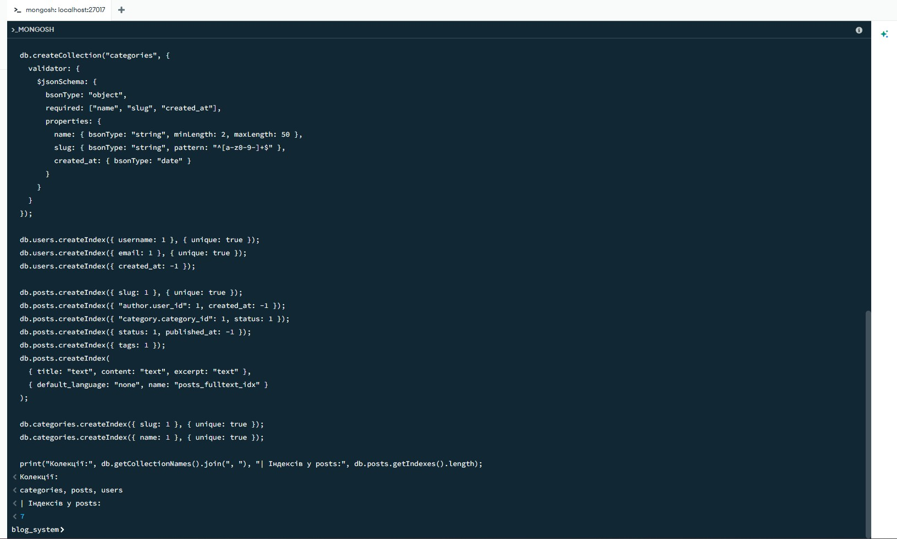
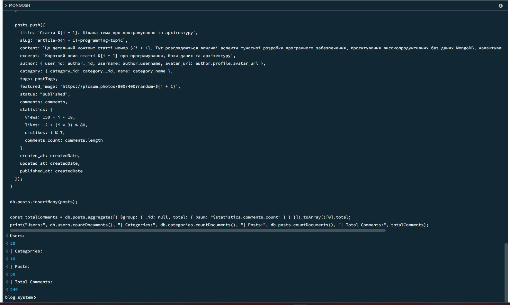
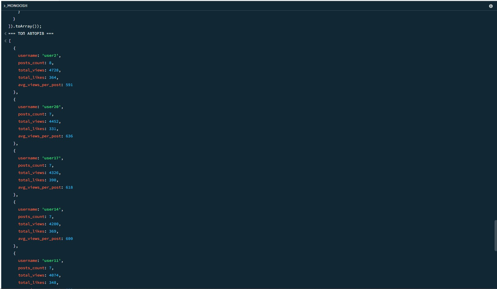
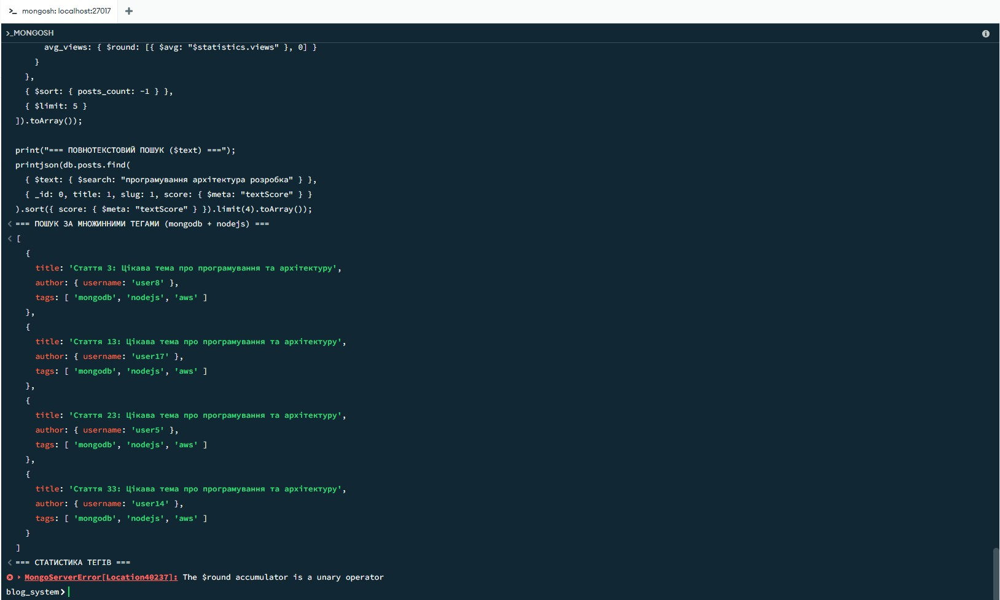
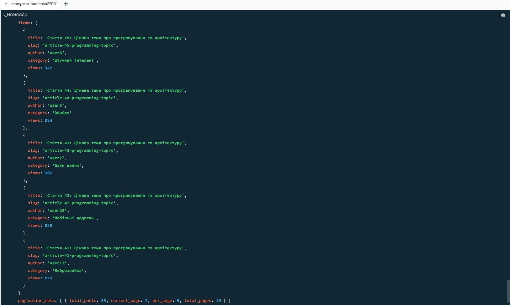
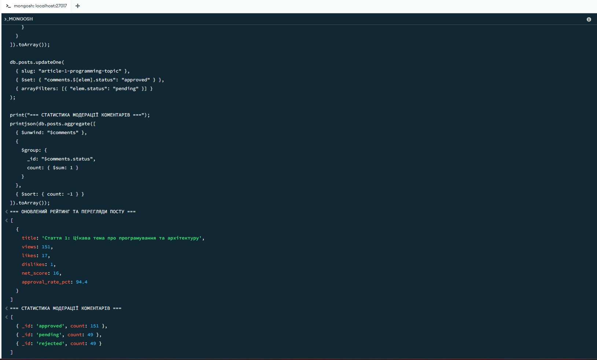

# Звіт з лабораторної роботи №7. Повний цикл розробки NoSQL застосунку з інтеграцією

## Загальна інформація

- **Здобувач освіти:** Зрелко Олександр Вадимович
- **Група:** ІПЗ - 32
- **Предметна область:** Блог-платформа (`blog_system`: колекції `users`, `posts`, `categories`)
- **Обраний рівень складності:** 2 (Достатній рівень — «добре»)

## Мета роботи

Застосувати знання роботи з NoSQL базами даних для створення повноцінного вебзастосунку, навчитися проєктувати документні схеми для реальних предметних областей, опанувати інтеграцію MongoDB з клієнтськими вебтехнологіями, розвинути навички аналізу та оптимізації продуктивності документо-орієнтованих систем.

## Виконання роботи (Рівень 1 та Рівень 2)

### Крок 1. Проєктування документних схем, валідація `$jsonSchema` та створення індексів

Для інформаційної системи блогу `blog_system` застосовано гібридний підхід до проєктування документної моделі з використанням патерну **Computed** (попереднє обчислення лічильників `views`, `likes`, `dislikes`, `comments_count`, `posts_count`):
- **Колекція `users`:** зберігає облікові записи з ролями (`admin`, `author`, `reader`), вбудований об'єкт профілю (`profile`) та агреговану статистику активності (`statistics`).
- **Колекція `categories`:** містить довідник рубрик блогу з унікальним `slug` і лічильником опублікованих статей.
- **Колекція `posts`:** містить статті з денормалізованими даними автора (`author`), категорії (`category`), масивом тегів (`tags`), об'єктом статистики (`statistics: { views, likes, dislikes, comments_count }`) та вбудованим масивом коментарів (`comments`) зі статусами модерації (`pending`, `approved`, `rejected`).

Нижче наведено скрипт створення колекцій із валідацією `$jsonSchema` та індексів (унікальних, складених за автором/датою і категорією/статусом, мультиключового для тегів та повнотекстового `text` з `default_language: "none"`):

```javascript
db = db.getSiblingDB("blog_system");
db.users.drop();
db.posts.drop();
db.categories.drop();

// 1. Створення колекції users із валідацією схеми
db.createCollection("users", {
  validator: {
    $jsonSchema: {
      bsonType: "object",
      required: ["username", "email", "password_hash", "role", "created_at"],
      properties: {
        username: { bsonType: "string", minLength: 3, maxLength: 30 },
        email: { bsonType: "string", pattern: "^[a-zA-Z0-9._%+-]+@[a-zA-Z0-9.-]+\\.[a-zA-Z]{2,}$" },
        password_hash: { bsonType: "string", minLength: 60 },
        role: { enum: ["admin", "author", "reader"] },
        status: { enum: ["active", "suspended", "deleted"] },
        created_at: { bsonType: "date" }
      }
    }
  }
});

// 2. Створення колекції posts із валідацією схеми
db.createCollection("posts", {
  validator: {
    $jsonSchema: {
      bsonType: "object",
      required: ["title", "content", "author", "created_at", "status"],
      properties: {
        title: { bsonType: "string", minLength: 3, maxLength: 200 },
        slug: { bsonType: "string", pattern: "^[a-z0-9-]+$" },
        content: { bsonType: "string", minLength: 100 },
        author: {
          bsonType: "object",
          required: ["user_id", "username"],
          properties: {
            user_id: { bsonType: "objectId" },
            username: { bsonType: "string" }
          }
        },
        status: { enum: ["draft", "published", "archived"] },
        created_at: { bsonType: "date" }
      }
    }
  }
});

// 3. Створення колекції categories із валідацією схеми
db.createCollection("categories", {
  validator: {
    $jsonSchema: {
      bsonType: "object",
      required: ["name", "slug", "created_at"],
      properties: {
        name: { bsonType: "string", minLength: 2, maxLength: 50 },
        slug: { bsonType: "string", pattern: "^[a-z0-9-]+$" },
        created_at: { bsonType: "date" }
      }
    }
  }
});

// 4. Створення індексів оптимізації
db.users.createIndex({ username: 1 }, { unique: true });
db.users.createIndex({ email: 1 }, { unique: true });
db.users.createIndex({ created_at: -1 });

db.posts.createIndex({ slug: 1 }, { unique: true });
db.posts.createIndex({ "author.user_id": 1, created_at: -1 });
db.posts.createIndex({ "category.category_id": 1, status: 1 });
db.posts.createIndex({ status: 1, published_at: -1 });
db.posts.createIndex({ tags: 1 });
db.posts.createIndex(
  { title: "text", content: "text", excerpt: "text" },
  { default_language: "none", name: "posts_fulltext_idx" }
);

db.categories.createIndex({ slug: 1 }, { unique: true });
db.categories.createIndex({ name: 1 }, { unique: true });

print("Колекції:", db.getCollectionNames().join(", "), "| Індексів у posts:", db.posts.getIndexes().length);
```



### Крок 2. Заповнення бази даних реалістичними даними (20 користувачів, 10 категорій, 50 постів, >200 коментарів)

Сгенеровано та додано 20 користувачів (адміністратори, автори, читачі), 10 ІТ-категорій, 50 статей із множинними тегами та понад 200 вбудованих коментарів із різними статусами модерації (`approved`, `pending`, `rejected`), лайками та дизлайками.

```javascript
function generateUsers(count) {
  const roles = ["admin", "author", "reader"];
  const users = [];
  for (let i = 0; i < count; i++) {
    users.push({
      username: `user${i + 1}`,
      email: `user${i + 1}@blog.com`,
      password_hash: "$2b$10$" + "x".repeat(53),
      role: roles[i % roles.length],
      profile: {
        full_name: `Користувач ${i + 1}`,
        bio: `Фахівець із розробки ПЗ та інженерії даних №${i + 1}`,
        avatar_url: `https://api.dicebear.com/9.x/avataaars/svg?seed=${i + 1}`,
        website: i % 3 === 0 ? `https://user${i + 1}.com` : null
      },
      statistics: { posts_count: 0, comments_count: 0 },
      created_at: new Date(Date.now() - (i + 10) * 86400000),
      last_login: new Date(),
      status: "active"
    });
  }
  return users;
}

db.users.insertMany(generateUsers(20));
const authors = db.users.find({ role: "author" }).toArray();

const categories = [
  { name: "Веброзробка", slug: "web-development", description: "Статті про сучасну веброзробку" },
  { name: "Мобільні додатки", slug: "mobile-apps", description: "Розробка мобільних застосунків" },
  { name: "Бази даних", slug: "databases", description: "NoSQL та реляційні бази даних" },
  { name: "DevOps", slug: "devops", description: "Автоматизація, Docker та CI/CD" },
  { name: "Штучний інтелект", slug: "ai", description: "ML та AI технології" },
  { name: "Хмарні технології", slug: "cloud", description: "AWS, Azure, Google Cloud" },
  { name: "Безпека", slug: "security", description: "Кібербезпека та захист даних" },
  { name: "UX/UI", slug: "ux-ui", description: "Дизайн та проєктування інтерфейсів" },
  { name: "Архітектура ПЗ", slug: "architecture", description: "Шаблони проєктування та мікросервіси" },
  { name: "Тестування", slug: "testing", description: "Автоматизоване та навантажувальне тестування" }
];
categories.forEach(c => { c.created_at = new Date(); c.statistics = { posts_count: 0 }; });
db.categories.insertMany(categories);

const categoryDocs = db.categories.find().toArray();
const allUsers = db.users.find().toArray();
const tagPool = ["javascript", "python", "mongodb", "react", "nodejs", "docker", "kubernetes", "aws", "typescript", "vue"];
const modStatuses = ["approved", "approved", "approved", "pending", "rejected"];

const posts = [];
for (let i = 0; i < 50; i++) {
  const author = authors[i % authors.length];
  const category = categoryDocs[i % categoryDocs.length];
  const postTags = [tagPool[i % tagPool.length], tagPool[(i + 2) % tagPool.length], tagPool[(i + 5) % tagPool.length]];
  const createdDate = new Date(Date.now() - (50 - i) * 3600000 * 24);

  const commentsCount = 4 + (i % 3); // 4, 5 або 6 коментарів (разом 250 коментарів)
  const comments = [];
  for (let c = 0; c < commentsCount; c++) {
    const commenter = allUsers[(i + c) % allUsers.length];
    comments.push({
      comment_id: new ObjectId(),
      author: { user_id: commenter._id, username: commenter.username },
      text: `Коментар №${c + 1} до статті ${i + 1}: практичний розбір теми оптимізації та розробки.`,
      created_at: new Date(createdDate.getTime() + (c + 1) * 3600000),
      status: modStatuses[(i + c) % modStatuses.length],
      likes: (i + c) % 15
    });
  }

  posts.push({
    title: `Стаття ${i + 1}: Цікава тема про програмування та архітектуру`,
    slug: `article-${i + 1}-programming-topic`,
    content: `Це детальний контент статті номер ${i + 1}. Тут розглядаються важливі аспекти сучасної розробки програмного забезпечення, проєктування високопродуктивних баз даних MongoDB, налаштування індексів та інтеграції з серверним середовищем Node.js.`,
    excerpt: `Короткий опис статті ${i + 1} про програмування, бази даних та архітектуру`,
    author: { user_id: author._id, username: author.username, avatar_url: author.profile.avatar_url },
    category: { category_id: category._id, name: category.name },
    tags: postTags,
    featured_image: `https://picsum.photos/800/400?random=${i + 1}`,
    status: "published",
    comments: comments,
    statistics: {
      views: 150 + i * 18,
      likes: 12 + (i * 3) % 80,
      dislikes: i % 7,
      comments_count: comments.length
    },
    created_at: createdDate,
    updated_at: createdDate,
    published_at: createdDate
  });
}

db.posts.insertMany(posts);

const totalComments = db.posts.aggregate([{ $group: { _id: null, total: { $sum: "$statistics.comments_count" } } }]).toArray()[0].total;
print("Users:", db.users.countDocuments(), "| Categories:", db.categories.countDocuments(), "| Posts:", db.posts.countDocuments(), "| Total Comments:", totalComments);
```



### Крок 3. Агрегаційні запити для статистики (Рівень 1)

Розроблено та виконано агрегаційні конвеєри для визначення топ-авторів за кількістю публікацій, найпопулярніших категорій та зведеної статистики коментарів (загальна кількість, середня та максимальна кількість на один пост).

```javascript
// 1. Топ авторів за кількістю постів та середньою кількістю переглядів
print("=== ТОП АВТОРІВ ===");
printjson(db.posts.aggregate([
  { $match: { status: "published" } },
  {
    $group: {
      _id: "$author.user_id",
      username: { $first: "$author.username" },
      posts_count: { $sum: 1 },
      total_views: { $sum: "$statistics.views" },
      total_likes: { $sum: "$statistics.likes" }
    }
  },
  { $sort: { posts_count: -1, total_views: -1 } },
  { $limit: 10 },
  {
    $project: {
      _id: 0,
      username: 1,
      posts_count: 1,
      total_views: 1,
      total_likes: 1,
      avg_views_per_post: { $round: [{ $divide: ["$total_views", "$posts_count"] }, 1] }
    }
  }
]).toArray());

// 2. Популярні категорії за кількістю постів
print("=== ПОПУЛЯРНІ КАТЕГОРІЇ ===");
printjson(db.posts.aggregate([
  { $match: { status: "published" } },
  {
    $group: {
      _id: "$category.category_id",
      category_name: { $first: "$category.name" },
      posts_count: { $sum: 1 },
      total_views: { $sum: "$statistics.views" },
      avg_likes: { $avg: "$statistics.likes" }
    }
  },
  { $sort: { posts_count: -1, total_views: -1 } },
  { $limit: 5 },
  {
    $project: {
      _id: 0,
      category_name: 1,
      posts_count: 1,
      total_views: 1,
      avg_likes: { $round: ["$avg_likes", 2] }
    }
  }
]).toArray());

// 3. Загальна та середня статистика коментарів на пост
print("=== СТАТИСТИКА КОМЕНТАРІВ ===");
printjson(db.posts.aggregate([
  { $match: { status: "published" } },
  {
    $group: {
      _id: null,
      total_posts: { $sum: 1 },
      total_comments: { $sum: "$statistics.comments_count" },
      avg_comments_per_post: { $avg: "$statistics.comments_count" },
      max_comments: { $max: "$statistics.comments_count" }
    }
  },
  {
    $project: {
      _id: 0,
      total_posts: 1,
      total_comments: 1,
      avg_comments_per_post: { $round: ["$avg_comments_per_post", 2] },
      max_comments: 1
    }
  }
]).toArray());
```



### Крок 4. Пошук за множинними тегами та повнотекстовий пошук (Рівень 2, п. 1–2)

Реалізовано пошук статей, які одночасно містять декілька заданих тегів (оператор `$all`), агрегацію популярності тегів через `$unwind`, а також повнотекстовий пошук за назвою, описом і текстом статті з ранжуванням за оцінкою релевантності (`$meta: "textScore"`).

```javascript
// 1. Пошук постів за множинними тегами одночасно ($all)
print("=== ПОШУК ЗА МНОЖИННИМИ ТЕГАМИ (mongodb + nodejs) ===");
printjson(db.posts.find(
  { tags: { $all: ["mongodb", "nodejs"] } },
  { _id: 0, title: 1, "author.username": 1, tags: 1 }
).limit(4).toArray());

// 2. Розподіл постів за тегами ($unwind)
print("=== СТАТИСТИКА ТЕГІВ ===");
printjson(db.posts.aggregate([
  { $match: { status: "published" } },
  { $unwind: "$tags" },
  {
    $group: {
      _id: "$tags",
      posts_count: { $sum: 1 },
      avg_views: { $round: [{ $avg: "$statistics.views" }, 0] }
    }
  },
  { $sort: { posts_count: -1 } },
  { $limit: 5 }
]).toArray());

// 3. Повнотекстовий пошук за назвою та змістом із сортуванням за релевантністю
print("=== ПОВНОТЕКСТОВИЙ ПОШУК ($text) ===");
printjson(db.posts.find(
  { $text: { $search: "програмування архітектура розробка" } },
  { _id: 0, title: 1, slug: 1, score: { $meta: "textScore" } }
).sort({ score: { $meta: "textScore" } }).limit(4).toArray());
```



### Крок 5. Пагінація списку постів через агрегаційний конвеєр `$facet` (Рівень 2, п. 4)

Реалізовано пагінацію через етап `$facet`, який за один запит повертає масив документів поточної сторінки (`items`) та метадані пагінації (`total_count`, поточна сторінка, загальна кількість сторінок).

```javascript
const page = 2;
const perPage = 5;

printjson(db.posts.aggregate([
  { $match: { status: "published" } },
  { $sort: { published_at: -1, _id: -1 } },
  {
    $facet: {
      items: [
        { $skip: (page - 1) * perPage },
        { $limit: perPage },
        {
          $project: {
            _id: 0,
            title: 1,
            slug: 1,
            author: "$author.username",
            category: "$category.name",
            views: "$statistics.views"
          }
        }
      ],
      pagination_meta: [
        { $count: "total_posts" },
        {
          $addFields: {
            current_page: page,
            per_page: perPage,
            total_pages: { $ceil: { $divide: ["$total_posts", perPage] } }
          }
        }
      ]
    }
  }
]).toArray());
```



### Крок 6. Статистика переглядів, система рейтингів (лайки/дизлайки) та модерація коментарів (Рівень 2, п. 3, 5, 6)

Реалізовано атомарну інкрементацію лічильника переглядів (`$inc: { "statistics.views": 1 }`), оновлення лайків і дизлайків із розрахунком відсотка схвалення посту, а також систему модерації коментарів зі зміною статусу вкладеного коментаря з `pending` на `approved` через `arrayFilters` і групуванням коментарів за статусами модерації.

```javascript
// 1. Інкрементація переглядів та додавання лайків/дизлайків (Рівень 2, п. 3, 5)
db.posts.updateOne(
  { slug: "article-1-programming-topic" },
  {
    $inc: {
      "statistics.views": 1,
      "statistics.likes": 5,
      "statistics.dislikes": 1
    }
  }
);

print("=== ОНОВЛЕНИЙ РЕЙТИНГ ТА ПЕРЕГЛЯДИ ПОСТУ ===");
printjson(db.posts.aggregate([
  { $match: { slug: "article-1-programming-topic" } },
  {
    $project: {
      _id: 0,
      title: 1,
      views: "$statistics.views",
      likes: "$statistics.likes",
      dislikes: "$statistics.dislikes",
      net_score: { $subtract: ["$statistics.likes", "$statistics.dislikes"] },
      approval_rate_pct: {
        $round: [
          {
            $multiply: [
              { $divide: ["$statistics.likes", { $add: ["$statistics.likes", "$statistics.dislikes"] }] },
              100
            ]
          },
          1
        ]
      }
    }
  }
]).toArray());

// 2. Модерація коментарів: переведення коментарів зі статусу pending у approved для Статті 1
db.posts.updateOne(
  { slug: "article-1-programming-topic" },
  { $set: { "comments.$[elem].status": "approved" } },
  { arrayFilters: [{ "elem.status": "pending" }] }
);

// 3. Зведена статистика коментарів за статусами модерації по всій базі
print("=== СТАТИСТИКА МОДЕРАЦІЇ КОМЕНТАРІВ ===");
printjson(db.posts.aggregate([
  { $unwind: "$comments" },
  {
    $group: {
      _id: "$comments.status",
      count: { $sum: 1 }
    }
  },
  { $sort: { count: -1 } }
]).toArray());
```



### Крок 7. Вебінтерфейс блогу з формою додавання постів, пошуком і фільтрацією за тегами (Рівень 1, п. 6 та Рівень 2, п. 7)

Розроблено серверний прошарок на Express.js (`server.js`) та клієнтський інтерфейс (`public/index.html`), який підтримує:
- відображення списку постів із картками, тегами, лічильниками переглядів, лайків і дизлайків;
- додавання нових постів через вебформу з миттєвим відображенням у сітці публікацій;
- повнотекстовий пошук та фільтрацію за одним або кількома тегами одночасно (`$all`);
- пагінацію сторінок та перегляд повного тексту статті зі статусами модерації коментарів у модальному вікні.


## Відповіді на контрольні запитання

1. **Які принципи слід враховувати при проєктуванні документної схеми для NoSQL баз даних?**
   - Схема в NoSQL проєктується від патернів доступу застосунку (Query-Driven Design), а не від абстрактної нормалізації. Враховують співвідношення операцій читання й запису, розмір документа (ліміт BSON — 16 МБ), кардинальність зв'язків («один-до-кількох» проти «багато-до-багатьох») та необхідність атомарного оновлення даних в межах одного документа.
2. **Коли доцільно використовувати вбудовані документи, а коли посилання між документами?**
   - Вбудовані документи (Embedding) доцільні, коли дочірні об'єкти тісно пов'язані з батьківським, завжди читаються разом і мають обмежену кількість (наприклад, профіль користувача, короткий список коментарів або тегів). Посилання (Referencing через `ObjectId`) використовують при зв'язках «багато-до-багатьох», коли пов'язані сутності редагуються незалежно (автори, категорії) або коли масив може необмежено рости.
3. **Поясніть переваги та недоліки денормалізації даних в документних базах даних.**
   - **Переваги:** висока швидкість читання одним запитом без дорогих операцій `JOIN`, локальність даних на диску.
   - **Недоліки:** дублювання даних збільшує обсяг сховища, а при зміні дубльованого поля (наприклад, `username` автора або назви категорії) необхідно оновлювати всі пов'язані документи.
4. **Як реалізувати ефективну пагінацію в MongoDB для великих обсягів даних?**
   - Для помірних вибірок зручно використовувати агрегаційний етап `$facet` (поєднує `$skip` + `$limit` і підрахунок `$count` в одному запиті). Для дуже великих колекцій замість великого `$skip` застосовують курсорну пагінацію (Keyset/Cursor Pagination) з фільтром за індексованим полем `{ published_at: { $lt: lastDate }, _id: { $lt: lastId } } .limit(N)`, що працює за сталий час $O(1)$.
5. **Що таке патерн "Bucket" і для яких завдань він використовується?**
   - Патерн «Bucket» (кошик) групує серію дрібних подій за певний часовий інтервал (наприклад, погодинна або поденна статистика переглядів посту за місяць) у масив всередині одного документа. Це зменшує кількість документів у колекції та розмір індексів, прискорюючи аналітичні вибірки часових рядів (Time-Series).
6. **Як забезпечити консистентність даних при денормалізації в MongoDB?**
   - Консистентність забезпечується за допомогою валідації `$jsonSchema` на рівні колекції, атомарних операторів модифікації (`$inc`, `$set`, `$push`), багатодокументних транзакцій (`session.startTransaction()`) при синхронному оновленні декількох колекцій або фонових завдань/Change Streams, які оновлюють кешовані поля.
7. **Які стратегії індексування найбільш ефективні для блог-системи?**
   - Поєднання унікальних індексів (`slug`, `email`, `username`), складених індексів за правилом ESR (Equality, Sort, Range — наприклад, `{ status: 1, published_at: -1 }` або `{ "author.user_id": 1, created_at: -1 }`), мультиключового індексу на масив `tags` та повнотекстового індексу `text` на поля `title`, `content`, `excerpt`.
8. **Поясніть різницю між горизонтальним та вертикальним масштабуванням баз даних.**
   - Вертикальне масштабування (Scale-Up) передбачає нарощування потужності одного сервера (CPU, RAM, NVMe), що має фізичну та фінансову межу. Горизонтальне масштабування (Scale-Out / Sharding у MongoDB) розподіляє дані та навантаження між багатьма серверами (шардами) у кластері за ключем шардингу.
9. **Як реалізувати транзакції в MongoDB і які обмеження вони мають?**
   - Операції в межах одного документа в MongoDB завжди атомарні. Для атомарної зміни кількох документів або колекцій використовують сесії (`client.startSession()`) та методи `withTransaction()` у конфігурації Replica Set або Sharded Cluster. Обмеження: вищі накладні витрати часу, ліміт часу виконання за замовчуванням (60 секунд) і необхідність розгортання реплікації.
10. **Які метрики продуктивності важливі при порівнянні реляційних та документних баз даних?**
    - Час виконання запиту (Latency / `executionTimeMillis`), пропускна здатність (Throughput, RPS/TPS), співвідношення перевірених документів/ключів до повернутих (`totalDocsExamined` vs `nReturned` в `explain("executionStats")`), споживання оперативної пам'яті під індекси та швидкість запису при масових вставках.

## Висновки

Під час виконання лабораторної роботи №7 було реалізовано повний цикл розробки NoSQL-застосунку для блог-системи `blog_system` на базі СУБД MongoDB:
1. Спроєктовано документні схеми колекцій `users`, `posts` та `categories` із використанням гібридного моделювання та патерну Computed; налаштовано сувору перевірку цілісності через `$jsonSchema` і комплекс індексів.
2. Заповнено базу даних реалістичним набором тестових даних: 20 користувачів, 10 категорій, 50 статей та 250 вбудованих коментарів.
3. Розроблено агрегаційні конвеєри для розрахунку топ-10 авторів, популярних категорій, статистики коментарів та пагінації через етап `$facet`.
4. Реалізовано функціональність Рівня 2: пошук за множинними тегами (`$all`), повнотекстовий пошук за назвою і змістом (`$text`), систему рейтингів (лайки/дизлайки), інкрементацію переглядів, модерацію коментарів (`arrayFilters`) та вебінтерфейс із формою додавання постів.

- **Самооцінка:** 4 (добре)
- **Обґрунтування:** Повністю виконано всі завдання Рівня 1 та Рівня 2: створено схему з валідацією та індексами, заповнено БД (50 постів, 250 коментарів, 20 користувачів, 10 категорій), реалізовано агрегаційні запити, пошук за тегами, повнотекстовий пошук, систему лайків/дизлайків, пагінацію через `$facet`, облік переглядів, модерацію коментарів і вебінтерфейс із формою створення посту.

